# ML-CLIPSim

Multi-Layer CLIP Similarity for Machine-Oriented Image Quality.

## Install the metric

Python 3.10+ and PyTorch are required. From the source checkout:

```bash
pip install .
```

Or install directly:

```bash
pip install "https://github.com/xiaobaoxia/ML-CLIPSim/releases/download/v0.1.0/mlclipsim-0.1.0-py3-none-any.whl"
```

[Download the wheel manually](https://github.com/xiaobaoxia/ML-CLIPSim/releases/download/v0.1.0/mlclipsim-0.1.0-py3-none-any.whl)

The Python package is named `mlclipsim` and contains only the metric and its
aggregation weights. CLIP ViT-B/16 downloads on first use.

## Use as a loss

Inputs are RGB float tensors `[B, 3, H, W]` in `[0, 1]`.

```python
from mlclipsim import MLCLIPSimLoss

criterion = MLCLIPSimLoss(device="cuda")
reconstruction = model(reference)
loss = criterion(reference, reconstruction)
loss.backward()
```

The loss is `1 - ML-CLIPSim`, averaged over the batch. Metric parameters stay
frozen; gradients flow to `reconstruction`. To include a bitrate term, use
`loss = rate_loss + lambda_mlcs * criterion(reference, reconstruction)`.

For similarity scores (higher is better):

```python
from mlclipsim import MLCLIPSim
metric = MLCLIPSim.from_pretrained(device="cuda")
score = metric(reference, reconstruction)
```

Offline loading: pass `clip_checkpoint="/path/to/ViT-B-16.pt"` to either loader.

## MLIC++ training and evaluation

These are source scripts, separate from the Python package. Run them from this
repository after installing their dependencies:

```bash
pip install -r requirements-research.txt
```

Pretrained MLIC++ models optimized with ML-CLIPSim. Download the checkpoints
below into `weights/codec/`:

| Quality | Lambda | Checkpoint |
| --- | --- | --- |
| 1 | 0.6 | [mlicpp_ml_clipsim_q1.pt](https://github.com/xiaobaoxia/ML-CLIPSim/releases/download/v0.1.0/mlicpp_ml_clipsim_q1.pt) |
| 2 | 2 | [mlicpp_ml_clipsim_q2.pt](https://github.com/xiaobaoxia/ML-CLIPSim/releases/download/v0.1.0/mlicpp_ml_clipsim_q2.pt) |
| 3 | 6 | [mlicpp_ml_clipsim_q3.pt](https://github.com/xiaobaoxia/ML-CLIPSim/releases/download/v0.1.0/mlicpp_ml_clipsim_q3.pt) |
| 4 | 10 | [mlicpp_ml_clipsim_q4.pt](https://github.com/xiaobaoxia/ML-CLIPSim/releases/download/v0.1.0/mlicpp_ml_clipsim_q4.pt) |
| 5 | 18 | [mlicpp_ml_clipsim_q5.pt](https://github.com/xiaobaoxia/ML-CLIPSim/releases/download/v0.1.0/mlicpp_ml_clipsim_q5.pt) |


Initialize training from a compatible MSE checkpoint:

```bash
python scripts/train_mlic.py --objective mlclipsim --lambda 2 \
  --checkpoint /path/to/mse-checkpoint.pt \
  --train-dir /path/to/train --val-dir /path/to/val --output-dir runs/codec
python scripts/evaluate_kodak.py --data /path/to/kodak \
  --weights-root weights/codec --device cuda --report outputs/kodak.json
```

Use `--objective mse` to train an MSE initialization yourself.

## Downstream tasks

```bash
python scripts/evaluate_imagenet.py --data /path/to/imagenet --quality 1 --output results/imagenet/q1
python scripts/evaluate_voc.py --data /path/to/VOC2007 --quality 1 --output results/voc/q1
python scripts/evaluate_coco.py --images /path/to/coco/val2017 \
  --annotations /path/to/instances_val2017.json \
  --tasks yolo maskrcnn clipseg groundingdino --quality 1 --output results/coco/q1
python scripts/evaluate_vlm.py --vlmeval-root /path/to/VLMEvalKit \
  --dataset POPE --model InternVL3-1B --quality 1 --output results/pope/internvl/q1
```

VOC needs [Detectron2](https://github.com/facebookresearch/detectron2).
VLM evaluation needs [VLMEvalKit](https://github.com/open-compass/VLMEvalKit) and
its model dependencies. Choose `InternVL3-1B` or `Qwen2.5-VL-3B-Instruct`, and
`POPE` or `SEEDBench_IMG`. Use `--model-path` for local model weights,
`--quality 1` through `5` for codec rate points, and `--limit N` for a subset.

## Results

Downstream curves from the paper. Click a plot for its vector PDF.

[ML-CLIPSim curve data (CSV)](results/mlclipsim_curves.csv): five rate points per task;
BPP is bits per pixel. Downstream values follow the paper; Kodak values are from
the released checkpoints.

<table>
<tr>
<td width="50%" align="center"><a href="figures/imagenet_clip.pdf">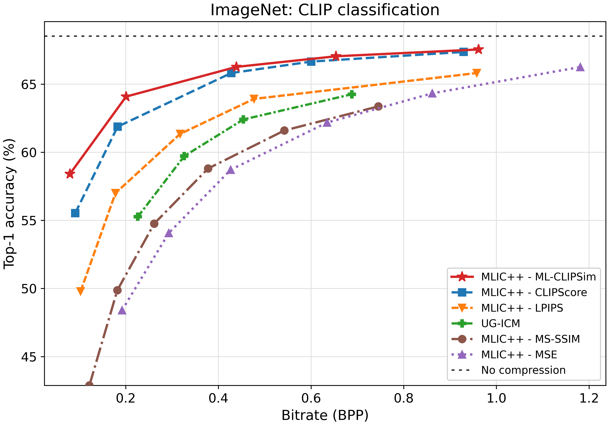</a></td>
<td width="50%" align="center"><a href="figures/coco_yolo.pdf">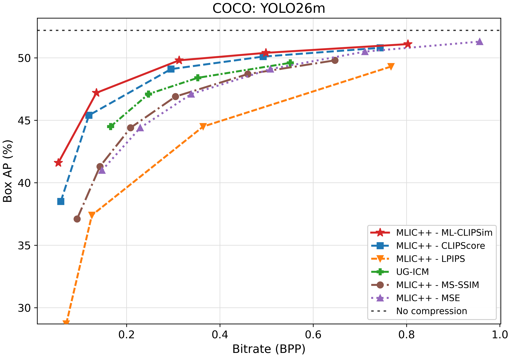</a></td>
</tr>
<tr>
<td width="50%" align="center"><a href="figures/voc_faster_rcnn.pdf">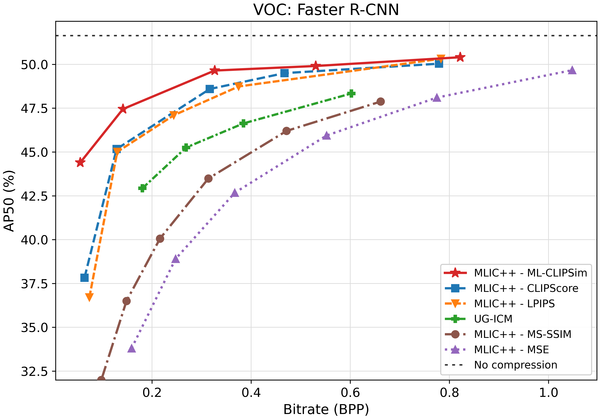</a></td>
<td width="50%" align="center"><a href="figures/coco_mask_rcnn.pdf">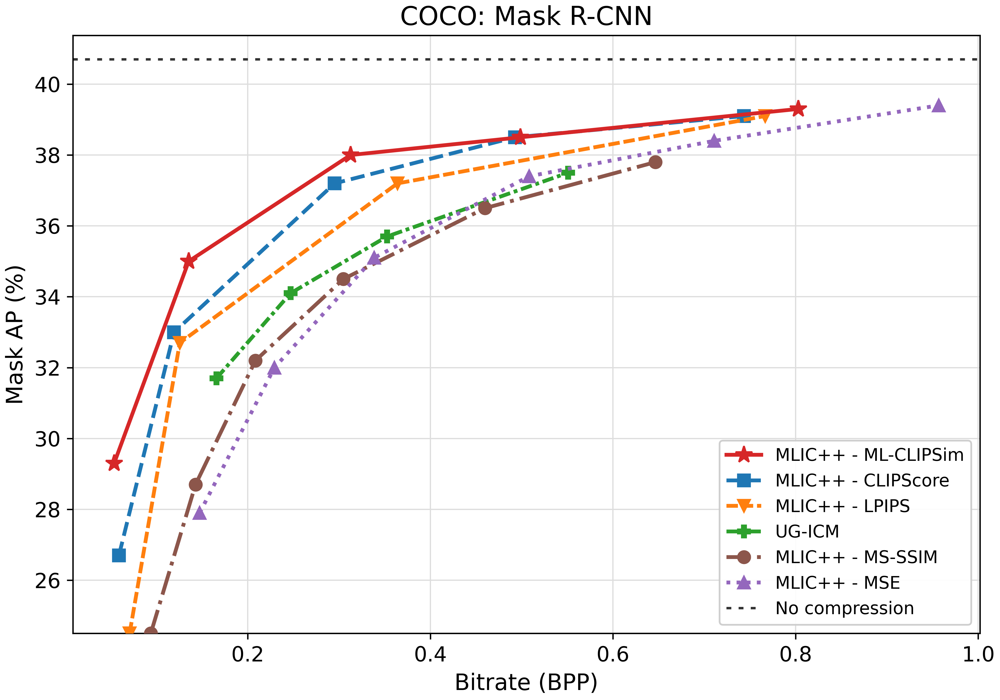</a></td>
</tr>
<tr>
<td width="50%" align="center"><a href="figures/coco_clipseg.pdf">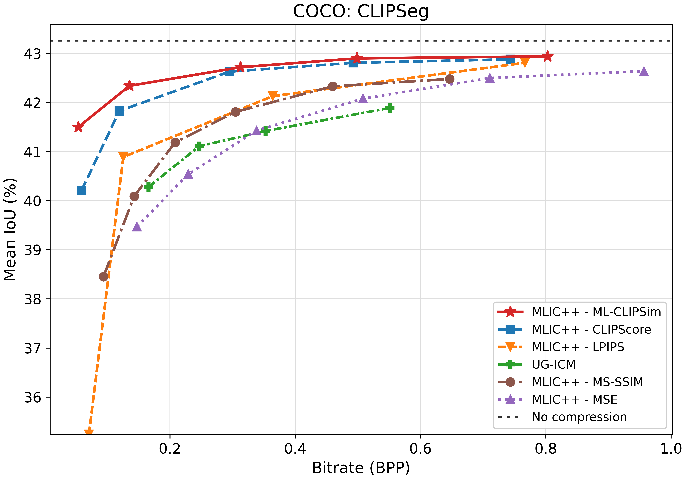</a></td>
<td width="50%" align="center"><a href="figures/coco_grounding_dino.pdf">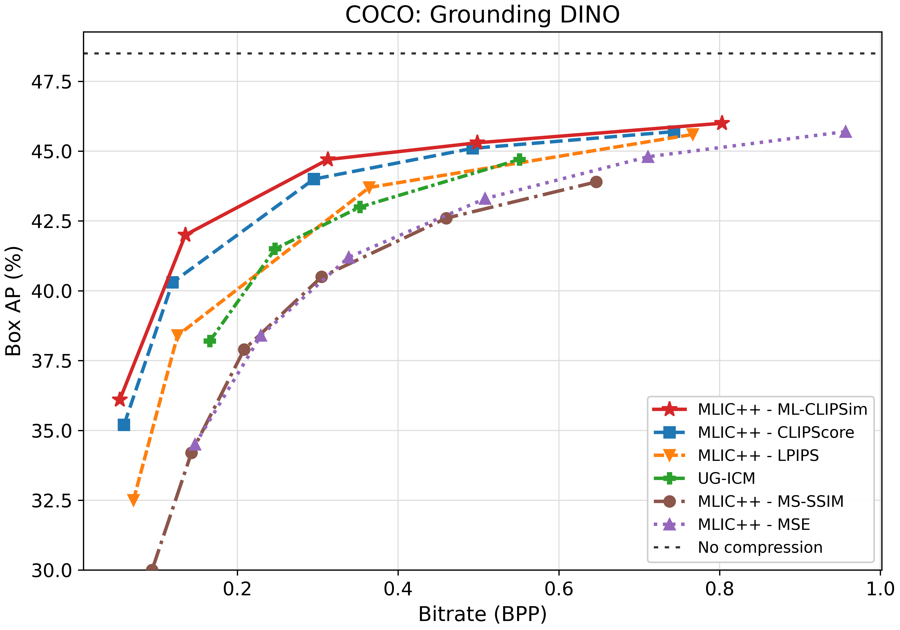</a></td>
</tr>
<tr>
<td width="50%" align="center"><a href="figures/seedbench_internvl.pdf">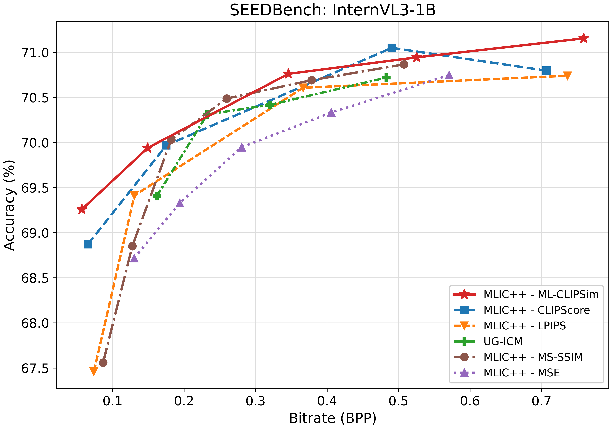</a></td>
<td width="50%" align="center"><a href="figures/seedbench_qwen.pdf">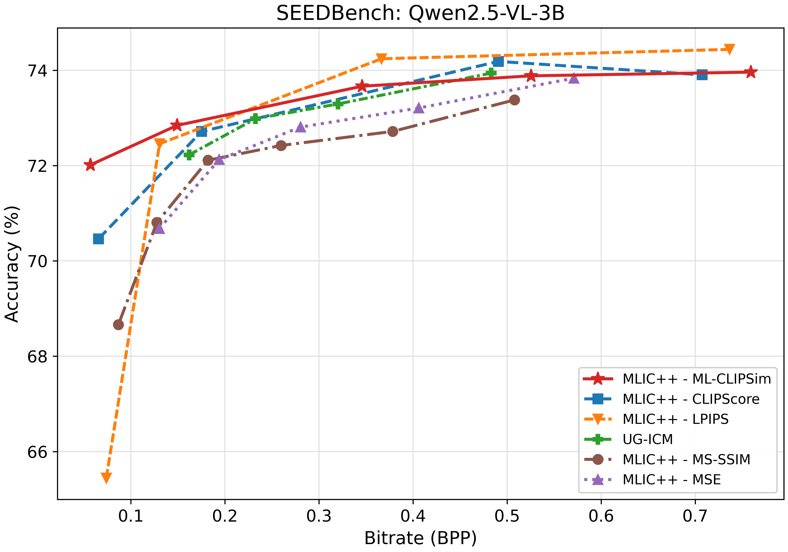</a></td>
</tr>
<tr>
<td width="50%" align="center"><a href="figures/pope_internvl.pdf">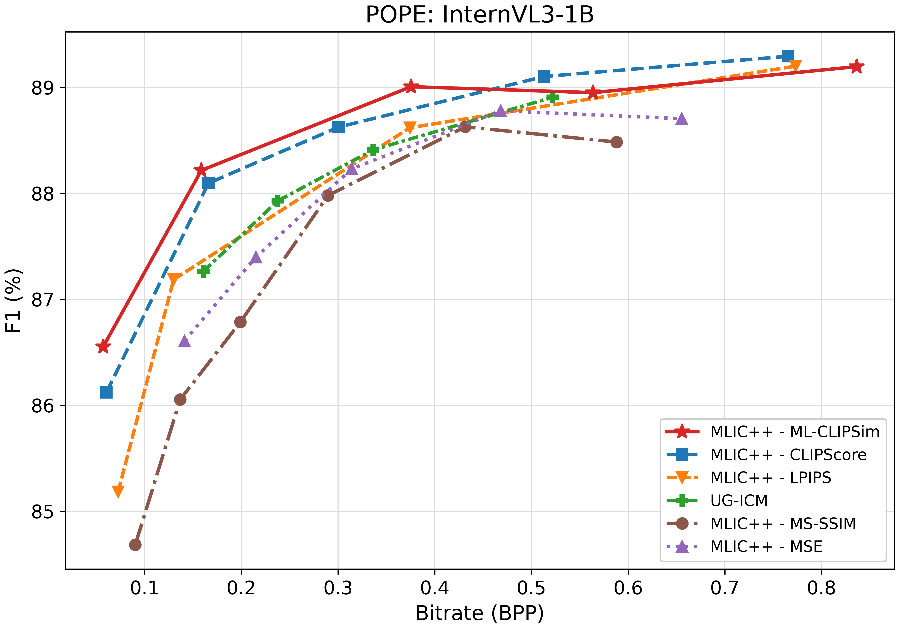</a></td>
<td width="50%" align="center"><a href="figures/pope_qwen.pdf">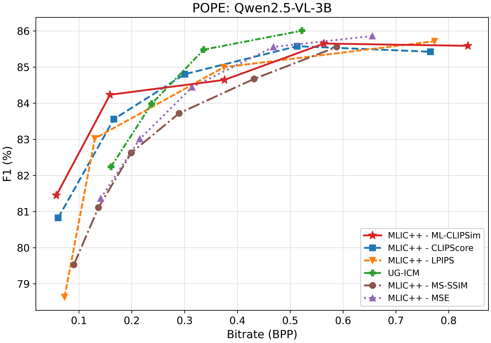</a></td>
</tr>
</table>

Kodak results with the released five codec checkpoints:

<table>
<tr>
<td width="50%" align="center"><a href="figures/kodak_psnr.pdf">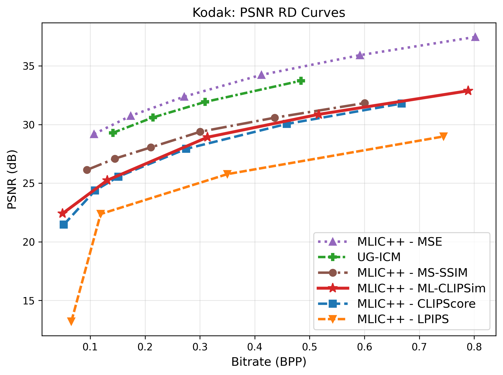</a></td>
<td width="50%" align="center"><a href="figures/kodak_msssim.pdf">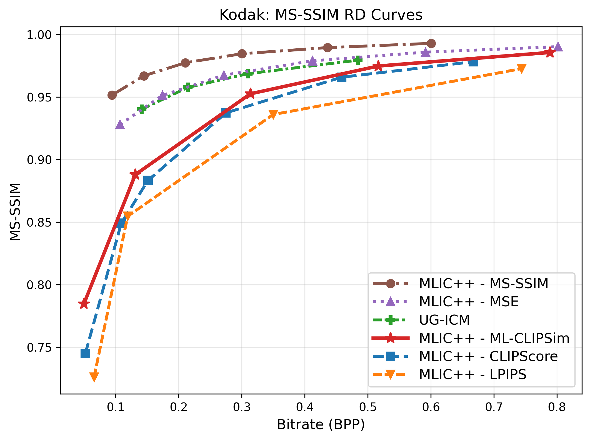</a></td>
</tr>
</table>

## Data and metric training

PCMP data is distributed separately via Google Drive: 2,000 references,
66 distortion points and 327,241 labeled pairs. Extract `pcmp-annotations.zip`
and all 48 `pcmp-images-*.zip` files as follows:

```bash
mkdir -p dataset
python -m zipfile -e /path/to/pcmp-annotations.zip dataset
for part in /path/to/pcmp-images-*.zip; do
  python -m zipfile -e "$part" dataset
done
python scripts/verify_dataset.py --full-images
python mlcs_metric/train.py --device cuda
```

Keep the supplied train/validation split; omit `--force_split`. Defaults: five
epochs, batch 64, learning rate `2e-4`, seed 123. Outputs: `runs/metric/`.
To create distortions and scores from COCO originals:

```bash
python scripts/prepare_reference_list.py --coco-root /path/to/coco/train2017 --output refs.txt
python mlcs_metric/generate_distortions.py --img_list refs.txt --out_root outputs/images
python mlcs_metric/make_mv_loss.py --dist_root outputs/images --out_dir outputs/labels --psnr_tol 0.5 --force_odd
```

Rebuild supplied labels with `python scripts/rebuild_dataset_labels.py --output outputs/labels`.
Use each script's `--help` for additional options.

## License

Code: Apache-2.0; data retains its original licenses.
Based on [MLIC++](https://github.com/JiangWeibeta/MLIC) and
[OpenAI CLIP](https://github.com/openai/CLIP). See [NOTICE](NOTICE).
